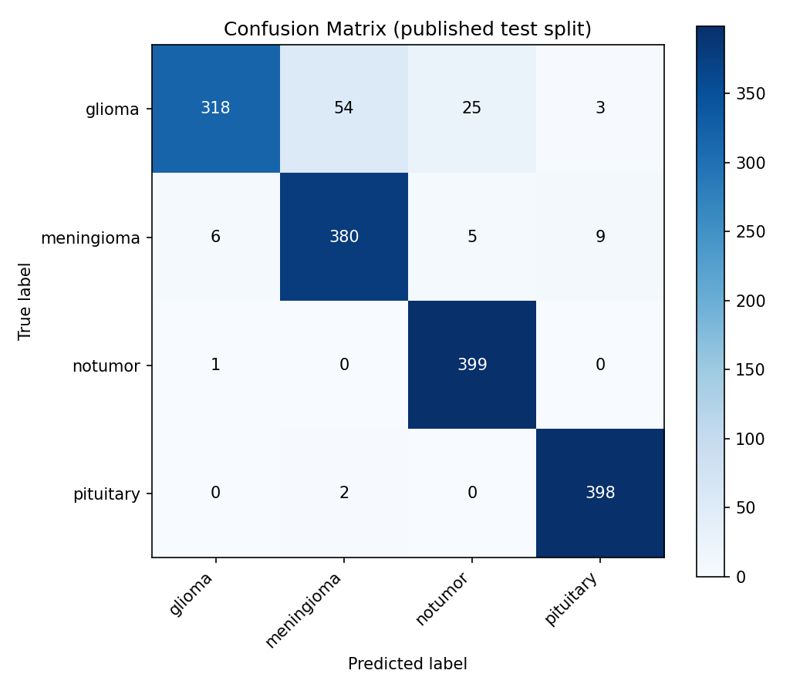
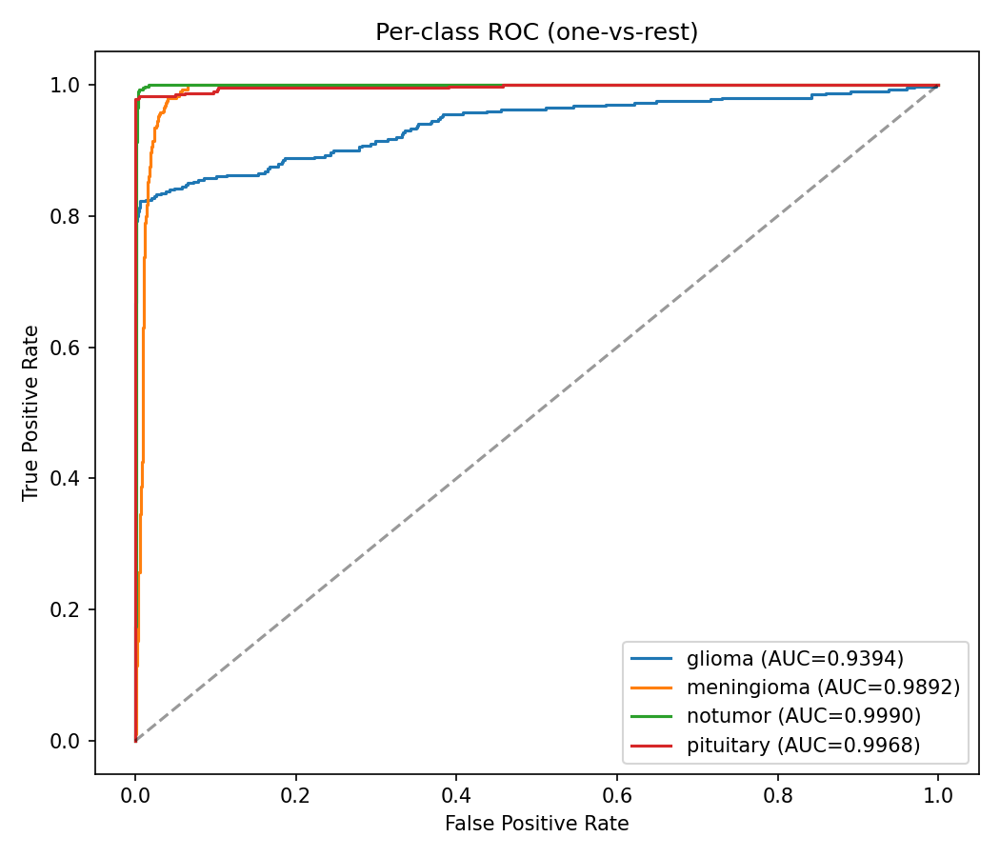
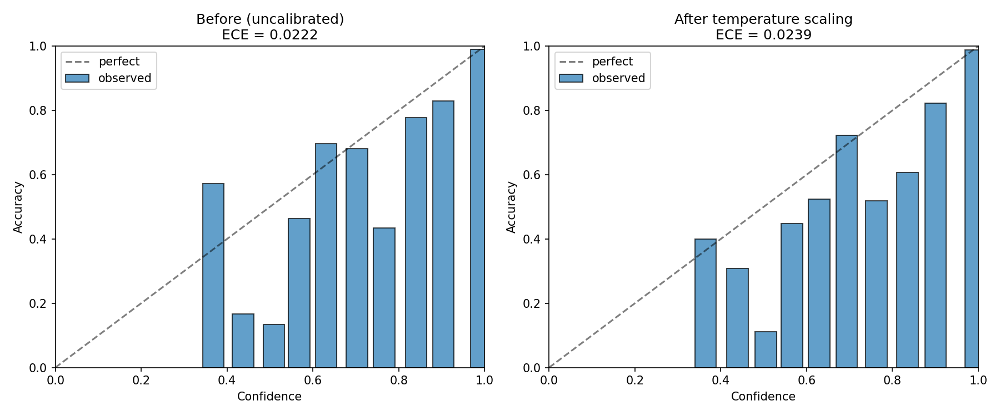
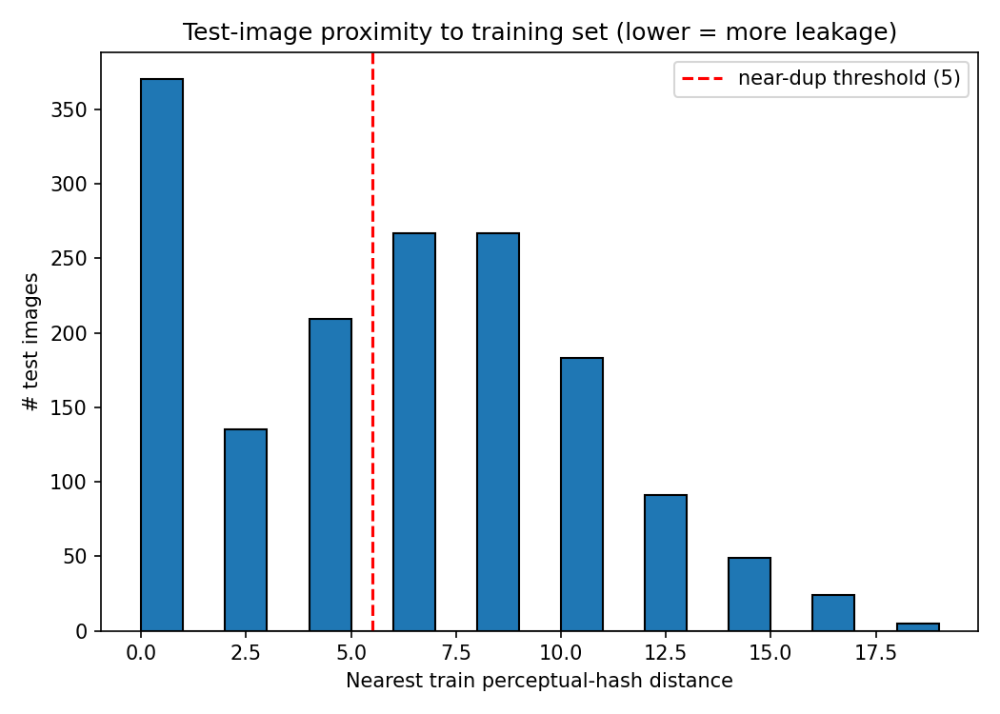
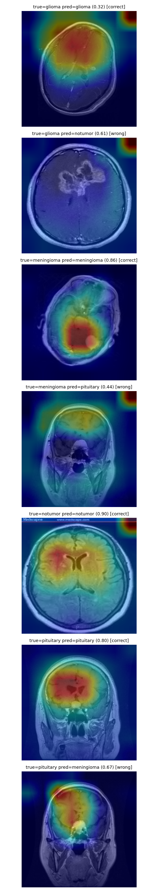
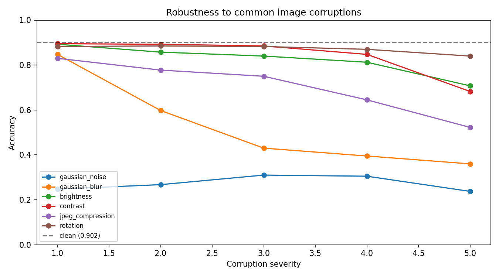
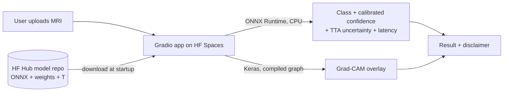

# NeuroClass — Brain Tumor MRI Classification

**Published baseline (IEEE 2024) + an audited, production-hardened extension.**

T1-weighted MRI brain-tumor classification across four classes
(`glioma`, `meningioma`, `notumor`, `pituitary`). This repository has two
clearly separated layers:

1. **Published Work (IEEE 2024)** — the original four-architecture benchmark,
   preserved byte-for-byte under [`/legacy`](legacy/) and never modified.
2. **Production Extension** — an independent audit of that benchmark plus the
   evaluation, calibration, explainability, serving, and testing work needed to
   deploy it honestly. All new code lives in [`src/btc`](src/btc/).

**🚀 Live demo:** [huggingface.co/spaces/Udit013/brain-tumor-mri-classifier](https://huggingface.co/spaces/Udit013/brain-tumor-mri-classifier)
· **🤗 Model:** [Udit013/brain-tumor-efficientnetb3](https://huggingface.co/Udit013/brain-tumor-efficientnetb3)
· **📄 Paper:** [DOI 10.1109/ICC-ROBINS60238.2024.10533941](https://doi.org/10.1109/ICC-ROBINS60238.2024.10533941)
· 

Upload an MRI to get the predicted class, a temperature-calibrated confidence,
a plain-language stability level (does the answer survive small changes to the
image?), a Grad-CAM overlay, and inference latency, alongside an explicit
not-a-medical-device disclaimer. The Space runs on free
CPU hardware and sleeps when idle; the first request after a sleep takes 1–2
minutes while it wakes.

---

## Section 1 — Published Work (IEEE 2024)

> **Citation.** "Identifying Various Types of Brain Tumors using Deep Neural
> Network based Image Features," 2024 International Conference on Cognitive
> Robotics and Intelligent Systems (ICC-ROBINS), IEEE, 2024.
> DOI: [10.1109/ICC-ROBINS60238.2024.10533941](https://doi.org/10.1109/ICC-ROBINS60238.2024.10533941).
> (Author is a co-author.)

**Dataset.** Msoud Nickparvar "Brain Tumor MRI Dataset" (Kaggle) — 7,023
T1-weighted MRI images compiled from figshare, SARTAJ, and Br35H, in 4 classes,
with a predefined split of **5,712 train / 1,311 test**.

**Preprocessing.** Resize to 256×256×3 RGB; random horizontal flip.

**Benchmark (four architectures, as published).**

| Model | Backbone / head | Params | Published accuracy |
|---|---|---|---|
| CNN (from scratch) | 6× Conv(7×7)+BN+MaxPool → Dense 1024→512→4 (grayscale, SGD) | 21.4M | 98.359% |
| VGG16 | ImageNet, last conv block fine-tuned → Dense 128→4 (Adam 1e-4) | 18.9M | 99.297% |
| InceptionV3 | ImageNet, frozen → Dense 256→128→4 (Adam 1e-3) | 40.7M | 97.734% |
| **EfficientNetB3** | ImageNet, trainable, `pooling='max'` → BN → Dense 512→256→4 (Adamax 1e-3) | **11.7M** | **99.844%** |

EfficientNetB3 had the top reported accuracy and the fewest parameters (38%
fewer than VGG16), so the extension uses it as the primary subject.

### What the published numbers actually measure

Re-reading the four notebooks shows every published accuracy is an exact
fraction of a **partial** test set, not the full 1,311 images. Each notebook
evaluates with `steps = 1311 // 32 = 40` batches:

| Model | Batch size | Images scored | Published accuracy | = correct / scored |
|---|---|---|---|---|
| CNN | 32 | 1,280 (98%) | 98.359% | 1,259 / 1,280 |
| VGG16 | 32 | 1,280 (98%) | 99.297% | 1,271 / 1,280 |
| InceptionV3 | 32 | 1,280 (98%) | 97.734% | 1,251 / 1,280 |
| EfficientNetB3 | **16** | **640 (49%)** | 99.844% | **639 / 640** |

Because the test generator is not shuffled, EfficientNetB3's 640 images are the
first half of the test set in file order, not a stratified sample, and the four
models were scored on different denominators. The EfficientNetB3 notebook's own
full-test-set classification report rounds to **0.99**, so the magnitude is
roughly right; the third decimal is not supported. All four notebooks also pass
the test set as `validation_data` and keep the checkpoint with the best
`val_accuracy`, so the test set influenced model selection.

---

## Section 2 — Production Extension

> ### Headline findings
> 1. **Train/test leakage inflates the benchmark.** A perceptual-hash audit
>    finds **44.6%** of test images have a near-duplicate in training (plus
>    **114** exact pixel duplicates). The paper's model scores **95.9%** on
>    those leaked images but **85.7%** on genuinely novel ones — a ~10-point gap
>    (the current model: 98.5% vs 89.4%). Patient IDs aren't recoverable from
>    the compilation, so this is a *lower bound*.
> 2. **The published numbers were scored on partial test sets** (above).
> 3. **Apple's Metal backend computes a different function in graph mode.**
>    The paper-recipe weights score 93.81% through `tensorflow-metal`'s graph
>    mode but **90.25% on CPU**; Metal's eager mode matches CPU. CPU TensorFlow and
>    ONNX Runtime agree with each other, and CPU is what the deployed demo runs —
>    so **every metric below is measured on CPU with the serving preprocessing**,
>    the computation users are actually served.
> 4. **The deployed model was retrained and is measurably better.** Selected on
>    a leakage-safe validation split and compared once on the test set with the
>    paper-recipe model it replaced (October 2026): accuracy **90.25% → 93.44%**,
>    novel-image accuracy **85.7% → 89.4%**, glioma recall **64.3% → 79.5%**,
>    mean accuracy under corruption **67.3% → 90.7%**, raw calibration error
>    **0.188 → 0.022**; the accuracy gains are paired-significant (McNemar
>    p ≤ 3e-4). See *The current model* below.

The extension re-trains the published EfficientNetB3 recipe with exact parity,
audits it with the modules below, and replaces it with a model trained to fix
what the audit found. It never reports a number that wasn't measured:
the tables in this README are written only by `scripts/fill_readme_results.py`
from the JSON files a real run produces.

### Modules
| # | Module | Code | Output |
|---|---|---|---|
| 0 | **Training the deployed model** (two-stage fine-tune) | [`finetune.py`](src/btc/finetune.py) | `models/EfficientNetB3_model_weights.h5` |
| 0b | Parity reproduction of the paper (+ BatchNorm recalibration) | [`train.py`](src/btc/train.py) | `models/EfficientNetB3_parity_weights.h5` |
| 1 | Evaluation (P/R/F1, confusion matrix, ROC-AUC, PR) | [`evaluate.py`](src/btc/evaluate.py) | `results/metrics/evaluation.json`, figures |
| 2 | **Leakage audit** | [`leakage.py`](src/btc/leakage.py) | `results/metrics/leakage.json` |
| 3 | External / out-of-distribution validation | [`external_validation.py`](src/btc/external_validation.py) | `results/metrics/external_validation.json` |
| 4 | Calibration (ECE + temperature scaling) | [`calibration.py`](src/btc/calibration.py) | `results/metrics/calibration.json`, reliability diagram |
| 5 | Explainability (compiled Grad-CAM) | [`explain.py`](src/btc/explain.py) | `results/figures/gradcam_montage.png` |
| 6 | Robustness to corruptions | [`robustness.py`](src/btc/robustness.py) | `results/metrics/robustness.json`, curves |
| 7 | Uncertainty (test-time augmentation) | [`uncertainty.py`](src/btc/uncertainty.py) | `results/metrics/uncertainty.json` |
| 8 | Drift monitoring stub (PCA + PSI) | [`monitoring.py`](src/btc/monitoring.py) | `models/drift_reference.npz`, `drift_log.jsonl` |
| 9 | ONNX export + latency benchmark | [`export_onnx.py`](src/btc/export_onnx.py) | `models/efficientnetb3.onnx`, `latency.json` |
| 10 | Serving: Gradio Space + FastAPI | [`space/app.py`](space/app.py), [`serve/app.py`](src/btc/serve/app.py) | live demo, REST API |
| 11 | Packaging, tests, CI | [`Dockerfile`](Dockerfile), [`requirements.txt`](requirements.txt), [`tests/`](tests/), [`ci.yml`](.github/workflows/ci.yml), [`MODEL_CARD.md`](MODEL_CARD.md) | pinned deps, lint + 65 tests on every push, verified Docker image |

### Results of the deployed model (measured on CPU)

<!-- RESULTS:BEGIN -->
> Auto-generated by `scripts/fill_readme_results.py` from `results/metrics/*.json` produced by `scripts/reproduce.sh`. Every value is measured — no placeholders.

| Metric | Value |
|---|---|
| Deployed model accuracy (full test set) | 93.44% |
| Published reference (paper) | 99.844% |
| Macro ROC-AUC / avg-precision | 0.993 / 0.983 |
| Exact cross-split duplicates | 114 / 1600 (7.1%) |
| Near-duplicates (phash≤5) | 714 / 1600 (44.6%) |
| Accuracy on near-duplicate vs leak-free images | 98.5% vs 89.4% |
| External OOD accuracy (binary collapse, n=253) | 72.7% |
| ECE before → after temperature scaling | 0.0222 → 0.0239 (T=0.937, fit on val report on test) |
| Single-image latency, Keras-CPU / ONNX-CPU / ONNX-CoreML | 78ms / 35ms / 20.3ms |
<!-- RESULTS:END -->

### Per-class performance

<!-- PERCLASS:BEGIN -->
| Class | Precision | Recall | F1 | ROC-AUC | Support |
|---|---|---|---|---|---|
| glioma | 0.978 | 0.795 | 0.877 | 0.984 | 400 |
| meningioma | 0.872 | 0.950 | 0.909 | 0.990 | 400 |
| notumor | 0.930 | 0.998 | 0.963 | 0.999 | 400 |
| pituitary | 0.971 | 0.995 | 0.983 | 0.999 | 400 |

**Weakest class: glioma.** Of 400 glioma test images, 54 are predicted as meningioma and **25 (6.2%) as `notumor`** — a missed-tumor error, the most consequential failure mode for any screening use.
<!-- PERCLASS:END -->

### Figures (generated by the run)

| Confusion matrix | Per-class ROC | Reliability diagram |
|---|---|---|
|  |  |  |

| Leakage proximity histogram | Grad-CAM overlays (4 classes, correct & wrong) |
|---|---|
|  |  |

Per-class precision-recall curves: [`results/figures/pr_curves.png`](results/figures/pr_curves.png).

### Robustness & uncertainty (measured)

<!-- ROBUSTNESS:BEGIN -->
**Robustness to common corruptions** (accuracy at severity 1 / 3 / 5; clean = 92.0%):

| Corruption | sev 1 | sev 3 | sev 5 |
|---|---|---|---|
| gaussian_noise | 92% | 91% | 85% |
| gaussian_blur | 92% | 90% | 80% |
| brightness | 92% | 92% | 92% |
| contrast | 92% | 93% | 92% |
| jpeg_compression | 92% | 92% | 87% |
| rotation | 93% | 91% | 87% |
| **mean corrupted** | | | **90.7%** |



**Uncertainty (Test-Time Augmentation):** mean predictive entropy **0.11 on correct** vs **0.78 on wrong** predictions (n=200) — the model is measurably less certain when it errs.
<!-- ROBUSTNESS:END -->

Entropy is about 7× higher on wrong predictions than on correct ones (the
previous model: 1.02 vs 0.82). These are averages and say nothing about how far
the two distributions overlap, so entropy should be one input to a "flag for
review" rule rather than a threshold on its own.

### Evaluation limitations (read this)

- **Train/test leakage (most important).** The published split is **image-level**
  over a multi-source compilation of 3-D scans. One patient yields many
  near-identical adjacent slices, and an image-level split can place siblings on
  both sides, so the model can recognise a test slice from a memorised training
  sibling. **Patient/scan IDs are not recoverable** from the Kaggle release (flat
  per-class JPGs, re-indexed filenames; SARTAJ/Br35H never carried IDs), so the
  leakage module reports an image-similarity **lower bound** and re-scores
  accuracy on the leak-free subset.

- **The paper's recipe used the test set for model selection.** Both the
  paper's notebooks and this repo's parity reproduction pick the checkpoint with
  the best `val_accuracy`, where validation *is* (part of) the test set, which
  biases their test metrics upward. The current model is selected on a
  leakage-safe validation split carved out of Training (`btc.splits`) and was
  scored on the test set once.

- **Metal graph-mode defect (root cause found).** On Apple Silicon,
  `tensorflow-metal` 1.1.0 computes the right function in *eager* mode (matches
  CPU to ~4e-6) but a different one in *graph* mode — `tf.function`, and so
  Keras `predict` and `fit`. For the deployed weights on the test set: CPU
  **90.25%**, Metal graph mode 93.81% (3.6% of predictions flipped). Turning off
  grappler's meta-optimizer makes Metal match CPU exactly (max difference
  1.2e-5, no flips); turning off any single built-in pass does not, which points
  at the plugin's own graph optimizer. The parity model was trained with `fit`
  on Metal, i.e. likely against the defective function, which would explain why
  that function scores higher than the deployed one. All evaluation and serving
  is pinned to CPU by `config.configure_inference_device()`;
  `config.disable_metal_graph_optimizer()` is the workaround when a GPU is used.
  Even with it, Metal gradients differ from CPU (median 4.7% on per-variable
  gradient norms), so training defaults to CPU.

- **Train/serve preprocessing skew (fixed).** Evaluation used to resize with
  Keras `load_img` (nearest-neighbour, as in the published notebooks) while
  both serving paths resize with PIL's default (bicubic), so the previous
  model's reported 91.25% described a computation nobody was served; measured
  on the serving path it scores **90.25%**. Every evaluation loader now uses
  `btc/preprocess.py`, the serving function (a test guards it, and another
  asserts the Space's preprocessing is byte-identical), and the current model
  is also *trained* on it, so it has no skew. The parity reproduction still
  resizes as published.

- **BatchNorm recalibration (previous model).** Under the published recipe (momentum 0.99,
  batch 16) the backbone's BatchNorm running statistics did not converge on
  Metal, so raw inference collapsed toward one class. `train.py` re-estimates
  those statistics with forward passes over training data (no weight update).
  Re-estimating them on CPU instead was tried and scored lower on CPU (89.19% vs
  91.25%, both under the previous evaluation preprocessing), so the current
  weights were kept. In hindsight the collapse is likely another symptom of the
  Metal graph-mode defect, which `fit` trained through.

- **Dataset drift since publication.** The live Kaggle dataset has been
  rebalanced since the paper: **5,600 train / 1,600 test (1,400 / 400 per
  class)** versus the paper's **5,712 / 1,311**. Reproduced numbers are on this
  different test set; `data.py` warns when counts differ.

- **Calibration protocol.** The temperature is fit on the validation split and
  ECE is reported on the test set, which played no part in fitting
  (`python -m btc.calibration`). The previous model trained on all of Kaggle
  Training, so its temperature had to be fit on the test set
  (`--fit-on test`, optionally `--holdout 0.5`).

- **Steps-per-epoch quirk (faithful reproduction).** The published notebook uses
  `steps_per_epoch = 5712 // 32 = 178` with batch size 16, so each epoch sees
  ~2,848 images rather than all 5,712. Preserved exactly for parity.

- **External validation taxonomy.** The out-of-distribution set is binary
  (tumor / no tumor), so the 4-class model is scored by collapsing its three
  tumor classes into one.

### The current model: how it was trained and validated

**A leakage-safe validation split.** `python -m btc.splits` carves 841
validation images (about 210 per class) out of Kaggle Training. It first groups
images into near-duplicate clusters (perceptual-hash distance ≤ 5, or identical
pixels) and keeps every cluster on one side. That matters: **43% of Training
images (2,399) sit in near-duplicate clusters**, the largest holding 22 slices,
so a random split would leak. Verified: **zero** near-duplicate pairs straddle
train and validation (the official test set has 714). The split is saved to
`results/splits/train_val_split.json`.

**The recipe** ([`finetune.py`](src/btc/finetune.py)) targets each weakness
measured on the paper's model. It trains on CPU (the deployed computation) with
the serving preprocessing, on the 4,759-image training side of the split, and
selects every checkpoint, learning-rate step and early stop on validation. It
is the standard two-stage EfficientNet fine-tune:

1. **Head only**, on cached features of the frozen ImageNet backbone (each
   training image and its mirror), Adamax 1e-3 — 17 seconds once the features
   are cached (2.5 min).
2. **Fine-tune from `block6a` up** with flips, small rotations/zooms/shifts,
   brightness/contrast and Gaussian noise, Adamax 1e-4 decayed on plateaus,
   BatchNorm frozen throughout. Backpropagation stops at 16×16 feature maps, so
   an epoch costs ~2.2 min on an M3 Pro CPU instead of ~6 for a full fine-tune.

Total training time: **21.5 minutes on a laptop CPU**. Every run writes its
config, seed, split hash, git revision, hardware, per-epoch history and
checkpoints to a gitignored `runs/` directory and resumes after an
interruption; the deployed model's record is
[`training.json`](results/metrics/training.json).
[`finetune_sanity_checks.py`](scripts/finetune_sanity_checks.py) runs seven
pre-flight checks first (label mapping, forward pass, frozen BatchNorm, finite
gradients, augmentation, an overfit test, graph mode == eager).

**Selection, on validation only.** Rule fixed before comparing: higher
validation accuracy wins unless the gap is under 1 point, then higher mean
accuracy under corruption. Head-only scored 96.79% vs 96.31% for the fine-tuned
model (a 4-image gap), so robustness decided: **92.4% vs 79.2%** mean accuracy
under the 30 corruption conditions on validation. Test-time augmentation moved
validation accuracy by ±0.24 points (+0.24 for one candidate, −0.24 for the
other) and was **not adopted**.

**One test-set comparison with the model it replaced**
([`model_comparison.json`](results/metrics/model_comparison.json), written by
[`compare_models.py`](scripts/compare_models.py)):

<!-- UPGRADE:BEGIN -->
| Metric (CPU, serving preprocessing) | Previous (parity, 2024) | **Current** |
|---|---|---|
| Test accuracy (n=1600) | 90.25% | 93.44% |
| Novel-image subset accuracy (n=886) | 85.67% | 89.39% |
| Near-duplicate subset accuracy | 95.94% | 98.46% |
| Macro F1 | 0.898 | 0.933 |
| Glioma recall (novel subset) | 64.25% (63.06%) | 79.50% (75.16%) |
| Gliomas predicted `notumor` (of 400) | 33 | 25 |
| Cross-entropy (lower is better) | 0.496 | 0.204 |
| ECE raw → temperature-scaled | 0.188 → 0.065 | 0.022 → 0.024 |
| Mean accuracy over 30 corruptions (n=400) | 67.32% | 90.68% |
| External OOD accuracy (n=253) | 69.57% | 72.73% |
| External tumor recall / no-tumor specificity | 50.32% / 100.00% | 56.13% / 98.98% |

Paired significance (exact McNemar): full test: 81 images only the current model gets right vs 30 only the previous one does, p = 1.4e-06; novel subset: 56 images only the current model gets right vs 23 only the previous one does, p = 2.6e-04; glioma: 70 images only the current model gets right vs 9 only the previous one does, p = 7.8e-13.

Calibration: previous — T fit on half the test set, ECE on the other half; current — T fit on the validation split, ECE on the full test set (T = 0.937).
<!-- UPGRADE:END -->

The current model needs little calibration: its raw ECE is already 0.022, and
the temperature fit on validation (T = 0.937) leaves test ECE essentially
unchanged. It had less training data than the previous model (4,759 vs 5,600
images; the rest is its validation split), and the previous model's checkpoint
was chosen on the test set, which flatters it — so the comparison, if anything,
favours the previous model. Glioma is still the weakest class: 25 of 400 glioma
test images (6.25%) are called `notumor`. Results come from a single training
seed.

**Two silent bugs found on the way, both fixed and guarded:**
- *Metal graph mode* (above): a first 3-epoch run on Metal reported 73.8%
  validation accuracy for a checkpoint that scores 71.6% on CPU. Training now
  defaults to CPU, and pre-flight check 7 fails on the defect.
- *A Keras architecture quirk*: EfficientNet gets an extra input layer,
  `Rescaling(1/sqrt(ImageNet std))`, only when built with
  `weights="imagenet"` (tensorflow#49930). The recipe trains from ImageNet
  weights; the evaluation and serving code builds with `weights=None`, so a raw
  checkpoint loaded there silently scored 86.7% instead of 95.0% on a
  validation sample. `export_for_serving()` folds the layer into the input
  `Normalization` variance — an exact identity, verified to 1e-6 and checked on
  every export — so the model runs on the unchanged serving architecture. (The
  previous model never had the layer at inference and is unaffected.)

**Rollback.** Every deployed model generation is preserved: the previous
model's weights, ONNX, live temperature (T = 0.561) and evaluation outputs are
in `models/archive/parity-2024/` with SHA-256 checksums, its metrics and
figures in [`results/archive/parity-2024/`](results/archive/parity-2024/), and
on the Hub at tag `parity-2024` (model repo and Space). The current model's
artifacts and one-time evaluation are in `models/archive/retrain-2026-10/`.
Two ways back:

- *Quick* (one setting, no code change): set the Space variable
  `NEUROCLASS_REVISION=parity-2024`. The Space then serves the previous model;
  only its "About" panel still describes the current one.
- *Full*: copy the previous model's files from the model repo's `parity-2024`
  tag back onto `main`, and restore the Space's code from its own
  `parity-2024` tag.

### Roadmap
1. Target the remaining glioma → `notumor` misses (6.25% on test).
2. Report results over several training seeds instead of one.
3. Upgrade the Space to Gradio 6 to clear its remaining dependency advisories.

---

## Live demo & deployment

The [Gradio Space](https://huggingface.co/spaces/Udit013/brain-tumor-mri-classifier)
runs on Hugging Face free-tier CPU. Inference (class + calibrated confidence +
stability level from 6 test-time-augmentation views) uses **ONNX Runtime**; Grad-CAM uses the Keras model, compiled
into a single graph. Weights are pulled from the
[HF Hub model repo](https://huggingface.co/Udit013/brain-tumor-efficientnetb3)
at startup, so the model is versioned separately from the app.



The deployed ONNX model is verified identical to the evaluated CPU model
(max |output difference| 0.0 against a fresh export).

**Deploy your own** (weights already on the Hub):
```bash
hf auth login
```
```bash
hf upload Udit013/brain-tumor-mri-classifier space/ . --repo-type space
```
Keep `python_version: "3.11"` in the Space README — TensorFlow 2.15 doesn't
support newer Python versions.

**Choosing the served model.** The Space serves the model repo's `main`
branch. The optional Space variable `NEUROCLASS_REVISION` (Space settings →
Variables) selects another branch, tag or commit: `candidate` is how a new
model is staged and smoke-tested before promotion, and `parity-2024` rolls back
to the previous model.

The FastAPI service takes `BTC_WEIGHTS` and `BTC_TEMPERATURE` paths for the same purpose.

### FastAPI service

```bash
uvicorn btc.serve.app:app --host 0.0.0.0 --port 8000
```
```bash
curl -F "file=@some_mri.jpg" http://localhost:8000/predict
```

| Endpoint | Behaviour |
|---|---|
| `GET /health` | `{"status","model_loaded","calibrated"}` — used by the Docker `HEALTHCHECK` |
| `POST /predict` | multipart `file` → class, calibrated + raw confidence, per-class probabilities, base64 Grad-CAM PNG, `inference_ms` / `gradcam_ms` / `latency_ms` |
| errors | `413` upload over 10 MB (enforced on bytes read, not the client's `Content-Length`); `400` unreadable or empty image; `422` no `file` field; `503` model failed to load (the server stays up and `/health` returns 503 with the cause) |

Measured on a laptop CPU (Apple M3 Pro, inference pinned to CPU), before → after
this repo's serving fixes:

| | Before | After |
|---|---|---|
| Warm `/predict`, server time (median) | ~420 ms (Grad-CAM ~380 ms) | **74 ms** wall-clock (41 ms inference + 30 ms Grad-CAM/PNG) |
| 16 concurrent `/predict` burst | 5.9 s | **1.2 s** |
| Worst `/health` latency during that burst | **3.3 s** | **57 ms** |

Two changes produced this. Grad-CAM's forward+backward pass is compiled once
with `tf.function` (232 → 26 ms, bit-identical heatmaps). And inference now runs
in a worker thread behind a lock, so it no longer freezes the event loop: before,
16 in-flight requests pushed `/health` toward the Docker healthcheck's 5 s
timeout, where a busy container would be marked unhealthy and restarted.

---

## Quickstart

```bash
# 1. Environment (creates .venv with Python 3.11 + pinned deps)
bash scripts/setup_env.sh
source .venv/bin/activate

# 2. Data (needs Kaggle credentials: ~/.kaggle/kaggle.json or KAGGLE_USERNAME/KAGGLE_KEY)
bash scripts/download_data.sh

# 3. Reproduce everything (train → evaluate → leakage → external → calibration →
#    Grad-CAM → ONNX/latency → robustness → uncertainty → drift reference)
bash scripts/reproduce.sh            # add --skip-train to reuse existing weights

# 4. Write the measured numbers into this README
python scripts/fill_readme_results.py

# 5. Tests (no TensorFlow, data, or weights needed)
PYTHONPATH=src pytest tests/ -q
```

### Docker
```bash
docker build -t neuroclass-api .
```
```bash
docker run -p 8000:8000 neuroclass-api
```
The deployed model is baked into the image; mount another `models/` directory
(`-v "$(pwd)/models:/app/models"`) to serve a different one.

Verified on Docker 29.9.2 (linux/arm64) with the deployed model:
- the image is 3.29 GB on disk, **715 MB compressed**; it ships only the served
  model (the rollback archive and the parity weights are excluded);
- it runs as the non-root `appuser`, which cannot write to `/app`, with the
  pinned stack (TF 2.15.0, FastAPI 0.142.2, Starlette 1.7.0, Pillow 12.3.0);
- predictions on the four example images equal the offline Keras-CPU
  predictions exactly; 413 oversized, 400 corrupt or empty, 422 no file,
  grayscale PNG accepted;
- 12 concurrent predictions complete in 1.4 s while `/health` stays under 45 ms;
  after warm-up a prediction including Grad-CAM takes ~120–150 ms;
- Docker's healthcheck reports **healthy**; with the weights missing the
  container keeps running, `/health` and `/predict` return 503 with the cause,
  and Docker reports **unhealthy** instead of a crash loop.

## Environment & dependencies

The published stack is **TensorFlow 2.15 / Keras 2** (required for parity),
which supports **Python 3.9–3.11 only**. `scripts/setup_env.sh` provisions a
3.11 virtualenv; on Apple Silicon it installs `tensorflow-macos` +
`tensorflow-metal` (see [`requirements-macos.txt`](requirements-macos.txt)).

**Security.** Dependencies are audited with `pip-audit`. Upgrading the serving
and imaging stack (FastAPI, Starlette, python-multipart, Pillow, scikit-learn,
ONNX, Protobuf) cut known advisories in `requirements.txt` from **57 to 22**
(vulnerable packages 7 → 3), verified by reproducing every evaluation metric
and the full API behaviour on the new versions. The remaining 22 are all
blocked by the TF 2.15 parity requirement: Keras 2.15 (fixes only in Keras 3),
ONNX (capped at 1.18 by TF's `ml_dtypes~=0.2` pin), and Protobuf (capped below
5). The app loads only its own model files, which limits exposure to the
model-loading advisories. The Space's Gradio 5.50 caps Pillow below 12 and
Starlette below 1.0, so those advisories need a Gradio 6 upgrade.

## Repository layout
```
legacy/                     # original four notebooks — byte-for-byte, read-only
src/btc/                    # production extension package
  config.py  data.py  model.py  train.py
  evaluate.py  leakage.py  external_validation.py  calibration.py
  explain.py  robustness.py  uncertainty.py  monitoring.py  export_onnx.py
  preprocess.py             # the one image preprocessing: serving, evaluation, training
  splits.py                 # leakage-safe train/val split of Kaggle Training
  finetune.py               # trains the deployed model (runs go to runs/, gitignored)
  serve/app.py              # FastAPI service
space/                      # Gradio app (app.py), its tested logic (logic.py), examples
scripts/                    # setup_env, download_data, reproduce, fill_readme_results,
                            #   v2_sanity_checks, evaluate_candidate
tests/                      # 65 tests: pure logic, Space logic, FastAPI contract (no TF)
results/                    # metrics, figures, and the train/val split (generated, tracked)
models/                     # weights, ONNX, temperature, drift reference (generated, ignored)
Dockerfile  requirements*.txt  pyproject.toml  MODEL_CARD.md  PROJECT_DOCUMENTATION_BrainTumor.md
```
