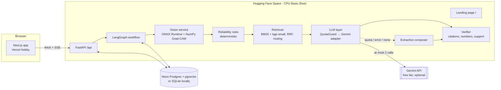
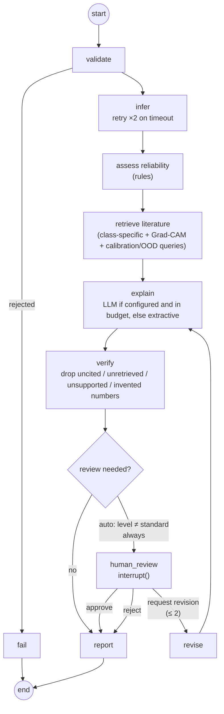

# Architecture

Decisions and rejected alternatives: [ADR 0001](adr/0001-platform-architecture.md)
(platform) and [ADR 0002](adr/0002-zero-cost-deployment.md) (zero-cost hosting,
LLM providers).

## System



Everything below `/api` is one Python process with a small thread pool. There
is no queue service, no cache service and no separate worker: the graph's
state lives in the database (LangGraph checkpointer + `analyses` rows), so a
restart resumes interrupted runs (`Services.recover`).

## Packages

| Path | Role |
|---|---|
| `legacy/` | the four IEEE 2024 notebooks, byte-for-byte |
| `src/btc/` | research package (TensorFlow): reproduction, audit, training, evaluation, ONNX export |
| `src/btc/export_serving.py`, `serving_math.py` | exports the serving bundle and verifies it against TensorFlow; closed-form Grad-CAM through the dense head |
| `src/neuroclass/vision/` | decoding and validation of uploads, quality checks, ONNX inference with 6 TTA views, temperature scaling, Mahalanobis input-shift distance, Grad-CAM overlay |
| `src/neuroclass/reliability.py` | deterministic rules over one result + the model's measured evaluation → standard / caution / unreliable |
| `src/neuroclass/rag/` | corpus (PMC open access, licence-filtered), chunking, local embeddings, BM25/dense/hybrid/routed retrieval, pgvector store |
| `src/neuroclass/agent/` | `graph.py` (LangGraph), `verify.py`, `compose.py` (extractive), `llm.py` (provider contract, QuotaGuard), `llm_gemini.py`, `llm_anthropic.py` |
| `src/neuroclass/api/` | FastAPI app, routers, auth, rate limits, SSE |
| `src/neuroclass/db/` | SQLAlchemy models, Alembic migrations |
| `src/neuroclass/registry.py` | model registry and promotion gate |
| `src/neuroclass/mcp_server.py` | read-only MCP server (local, stdio) |
| `web/` | Next.js 16 + TypeScript + Tailwind v4 frontend |
| `deploy/hf_space/` | the Space entrypoint and its build script |

## The analysis workflow (LangGraph)



- **Typed state and contracts.** Each node takes and returns parts of
  `AnalysisState`; inputs and outputs are Pydantic models (`schemas.py`).
- **Determinism where it matters.** Reliability and verification are plain
  functions with tests; the LLM only drafts text that the verifier filters.
- **Bounded execution.** Inference retries at most twice on timeout; revisions
  at most twice; the LLM makes at most `tool_rounds + 1` calls (default 2).
- **Human in the loop.** `interrupt()` pauses the run; the checkpoint is in the
  database; `POST /analyses/{id}/reviews` resumes it with `Command(resume=...)`.
  Anonymous visitors run with review off (`review_mode=never`); signed-in users
  choose `auto` (review when the level isn't standard) or `always`.
- **Tracing.** Every node writes started/completed/failed/interrupted events
  with durations and details (LLM mode, tool calls, token counts, fallback
  reason) to `trace_events`; the UI shows them and SSE streams them.

## The LLM layer

```
agent/llm.py          provider-neutral: prompts, TOOL_SPECS, untrusted-data wrapping,
                      LlmResult, LlmUnavailable / QuotaExhausted, QuotaGuard, ToolRunner
agent/llm_gemini.py   free tier; tool round with function declarations, then one call
                      with response_json_schema; SDK retries off; 429 → pause
agent/llm_anthropic.py paid, opt-in (NEUROCLASS_ALLOW_PAID_LLM=true); same contract
```

`Services.explainer()` picks the adapter from `settings.resolved_llm_provider`
(`auto` → Gemini if a key exists, else none). The graph and the research router
only see the `Explainer` protocol, so changing providers touches neither.

## Retrieval

- Corpus: 241 PubMed Central open-access articles whose JATS XML declares a
  Creative Commons licence (ND excluded; 51 rejected), plus the project's own
  README, model card and documentation (MIT). Provenance per document: PMCID,
  DOI, licence, URL. See [PROVENANCE.md](PROVENANCE.md).
- Chunking: section-aware, ~220-word chunks, sentence boundaries; 7,355 chunks.
- Search: BM25 and bge-small dense scores fused with reciprocal rank fusion
  (k = 60); project-question routing by pattern; at most two chunks per
  document; optional cross-encoder rerank (off: see the evaluation).
- Stores: pgvector HNSW with iterative scan (on the Space, synced from the
  bundled index on first start, idempotent) with the in-process exact search as
  an automatic fallback when the database is unreachable; locally, the in-process
  store. They return the same results (tested).

## Data and storage

| Table | Contents | Retention |
|---|---|---|
| `analyses` | owner key, status, inference JSON (incl. Grad-CAM PNG), reliability, explanation, errors | until deleted by the operator |
| `reviews` | reviewer, decision, note | with the analysis |
| `trace_events` | per-step events (no image data) | with the analysis |
| `users` | email, scrypt hash, role | until deleted |
| `llm_usage` | calls/tokens per UTC day | small, kept |
| `index_versions`, `documents`, `chunks` | the pgvector copy of the index (optional) | replaced on load |
| LangGraph checkpoint tables | graph state for pause/resume | with the run |

Uploaded files are written with mode 0600 for the duration of a run and deleted
by an hourly job after `NEUROCLASS_UPLOAD_RETENTION_HOURS` (24).

## Failure modes

| Failure | Behaviour |
|---|---|
| Model bundle missing/corrupt | checksum check fails; `/ready` 503 with cause; benchmarks and literature still served |
| Literature index unavailable | analyses run without passages; `/ready` shows retrieval down |
| No LLM, LLM budget used, provider 429/5xx/timeout/refusal/bad JSON | extractive explanation, `fallback_reason` shown |
| Database down (e.g. Neon suspended) | API answers 503 "temporarily unavailable" where data is needed; retrieval falls back to the in-memory index; research answers, benchmarks and samples keep working; tracing and the LLM ledger degrade silently (the in-process quota guard still applies) |
| Process restart mid-run | runs resume from the checkpoint; paused reviews stay paused |
| Space asleep | first request wakes it (cold start) |
